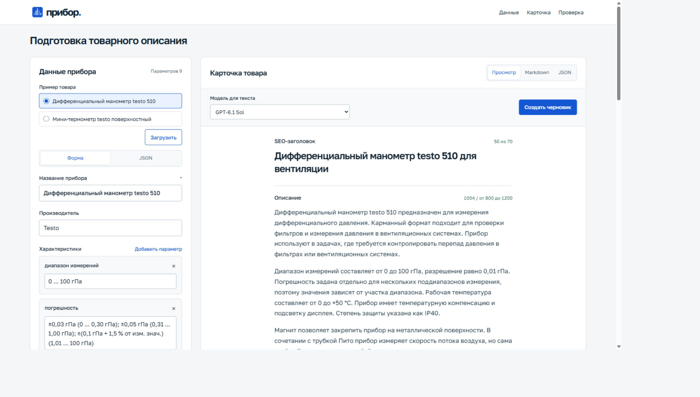

# Прибор

AI-помощник для контент-менеджера B2B-магазина измерительных приборов. Преобразует JSON или данные формы в товарное описание с SEO-заголовком, характеристиками, поисковыми запросами и блоком для менеджера. Показывает пропуски и предупреждения перед публикацией.

Python + FastAPI, обычные HTML/CSS/JavaScript. Локальный запуск, без базы данных и сборки фронтенда. Модель по умолчанию **GPT-6.1 Sol**, запрошенный уровень рассуждения **high**, OpenAI-совместимый API.



## Запуск

Нужен Python 3.11+. Установка проверена в новом окружении Python 3.12.14. Node.js для работы приложения не требуется.

Получите исходники и перейдите в папку проекта

```bash
git clone https://github.com/famelikolbut5/pribor-studio.git
cd pribor-studio
```

Можно также скачать ZIP через меню Code на GitHub, распаковать его и открыть терминал в папке с `README.md`.

### Windows PowerShell

```powershell
python --version
python -m venv .venv
.\.venv\Scripts\python.exe -m pip install -r requirements.txt
Copy-Item .env.example .env
```

Откройте созданный `.env` в текстовом редакторе и заполните `LLM_API_KEY`. Остальные параметры для проверенного провайдера уже указаны. Затем запустите сервер.

```powershell
.\.venv\Scripts\python.exe -m uvicorn app.main:app --host 127.0.0.1 --port 8765
```

### macOS и Linux

```bash
python3 --version
python3 -m venv .venv
.venv/bin/python -m pip install -r requirements.txt
cp .env.example .env
```

Откройте `.env` в текстовом редакторе и заполните `LLM_API_KEY`, затем запустите сервер.

```bash
.venv/bin/python -m uvicorn app.main:app --host 127.0.0.1 --port 8765
```

Откройте [редактор](http://127.0.0.1:8765/) или [Swagger UI](http://127.0.0.1:8765/api/docs). Без ключа можно изучить два сохранённых результата. Новая генерация без ключа возвращает понятную ошибку.

Терминал с сервером должен оставаться открытым. Для остановки нажмите `Ctrl+C`. После изменения `.env` перезапустите сервер. Если порт 8765 занят, укажите другой порт в команде запуска и откройте тот же адрес с новым портом.

Если команда `python` или `python3` не найдена, установите Python 3.11+ и заново откройте терминал. Версию проверяет первая команда в инструкции. Не перезаписывайте `.env` при повторном запуске, шаг копирования нужен только при первой настройке.

## Настройка API

| Переменная | Назначение | Значение в примере |
|---|---|---|
| `LLM_API_KEY` | Ключ на сервере | Пустое, заполните самостоятельно |
| `LLM_BASE_URL` | OpenAI-совместимый API | `https://limitdeckai.ru/v1` |
| `LLM_MODEL` | Модель по умолчанию | `gpt-6.1-sol` |
| `LLM_REASONING_EFFORT` | Запрошенный уровень рассуждения | `high` |

Реальные проверки выполнены с этим провайдером. Другой совместимый API должен поддерживать Chat Completions, JSON Schema и выбранные параметры модели. Скрытого переключения на другую модель нет. Самостоятельно подлинность модели за посредником и фактическое исполнение `high` установить нельзя.

## Работа в редакторе

1. Заполните форму или вставьте JSON. Обязательно только название, значения характеристик передаются строками или `null`.
2. Нажмите «Создать черновик». Ошибка API сохраняет ввод и предыдущую карточку.
3. Проверьте значения, блок уточнений и предупреждения. Заголовок и описание можно исправить прямо в редакторе.
4. Скопируйте Markdown или JSON либо скачайте JSON. Экспорт содержит карточку и учитывает ручные правки.

Отметьте один из двух вариантов в блоке «Пример товара» и нажмите «Загрузить». Это открывает сохранённый реальный ответ и не вызывает модель. Сам выбор варианта не заменяет введённые данные. Изменение источника помечает карточку как устаревшую. Отмена ожидания в браузере не гарантирует отмену обработки и списания у провайдера.

[Самостоятельная проверка в четыре шага](docs/manual-check.md).

## Два примера

| Товар | Заголовок / описание, символов | Результат |
|---|---:|---|
| Дифференциальный манометр testo 510 | 50 / 1004 | [Markdown](examples/testo-510.output.md) · [JSON](examples/testo-510.output.json) |
| Мини-термометр testo поверхностный | 50 / 949 | [Markdown](examples/testo-mini.output.md) · [JSON](examples/testo-mini.output.json) |

Входные данные и `source_url` лежат рядом с результатами в [examples](examples). Товары выбраны из предоставленного каталога СОЮЗ-ПРИБОР. Отдельная пара товаров от работодателя не была передана, поэтому эти примеры демонстрационные.

Файлы `*.output.json` содержат полный ответ приложения с карточкой, проверками и метаданными API. Вкладка JSON и скачивание в редакторе экспортируют только объект `card`. [Отчёт о реальных вызовах](docs/model-evaluation.md) включает успешные и отклонённые результаты.

## Контракт

```json
{
  "model": "gpt-6.1-sol",
  "product": {
    "name": "Манометр показывающий DM 02",
    "manufacturer": "Манотомь",
    "specs": {
      "диапазон измерений": "0–1,6 МПа",
      "класс точности": "1,5"
    },
    "description": "Прибор предназначен для измерения избыточного давления."
  }
}
```

Это тело `POST /api/generate`. JSON во входном поле редактора содержит только `product`, без внешней обёртки. Полная схема доступна в [OpenAPI](http://127.0.0.1:8765/openapi.json).

Результат включает `seo_title`, `seo_description`, `key_specs`, `search_queries`, `commercial`, `missing_data`, `warnings` и `status`. Ограничения проверяются кодом. Заголовок до 70 символов, описание от 800 до 1200 с пробелами и переводами строк, запросов от 3 до 5.

Для почти пустого входа допускается короткий запрос уточнений с `needs_data` вместо искусственного описания. Это осознанное исключение по длине. При содержательном входе статус `needs_data` не отключает ограничения длины.

## Промпт и достоверность

Промпт находится в [app/prompt.py](app/prompt.py), схема в [app/schemas.py](app/schemas.py), проверки в [app/validation.py](app/validation.py).

Заполненные `specs` переносятся дословно. Из паспорта можно извлечь отсутствующее значение только как непрерывный фрагмент исходного `description`, с единицами и условиями. Неизвестные сведения получают «данных нет». Промпт отдельно различает поверку и калибровку, опцию и комплект, средний ресурс и гарантированный предел. Противоречия требуют уточнения.

JSON Schema задаёт форму ответа, Pydantic и отдельные проверки контролируют содержание. При ошибке содержания допускается одно исправление с предыдущим ответом и замечаниями. Ошибки сети и API, отказ и обрезанный ответ автоматически не повторяются. [Обоснование решений](docs/prompt-decisions.md).

## Проверки

```bash
python -m unittest discover -s tests -q
```

63 Python-теста проверяют контракт, защиту запроса, ограничения карточки и обработку ошибок API. 14 тестов чистого модуля ввода можно запустить при наличии Node.js 18+.

```bash
node --test tests/input.test.mjs
```

Моки используются для воспроизводимой проверки ошибок, а не для оценки LLM. Отдельно выполнены реальные вызовы модели, проверка нового окружения и браузерные сценарии. [Протокол проверки](docs/verification.md) · [Сверка каждого пункта ТЗ](docs/requirements-checklist.md).

## Ограничения и развитие

Автоматическая проверка чисел и дословных значений не доказывает правильность всех смысловых связей. Проверка редактором остаётся обязательной. Указанные поисковые запросы не подкреплены статистикой частотности. Качество зависит от полноты и достоверности источника.

Приложение предназначено для `127.0.0.1`, без публичной авторизации и истории карточек. Ключ остаётся на сервере, `.env` исключён из Git. Проверяются Host, Origin, размер и структура запроса, текст выводится безопасными DOM-методами. [Защита и её границы](docs/security.md).

При `high` генерация может занимать несколько минут, включая единственное исправление. Общий предел одного обращения к провайдеру 300 секунд. Товарные данные передаются настроенному API-провайдеру.

Возможные улучшения включают расширение эталонного набора приборов, привязку утверждений к источнику и независимую редакторскую оценку. Шрифт поставляется локально, лицензия в [app/static/fonts](app/static/fonts).
